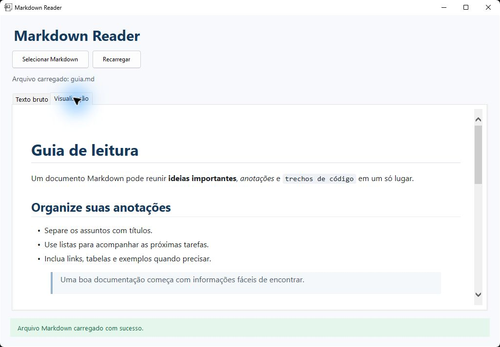
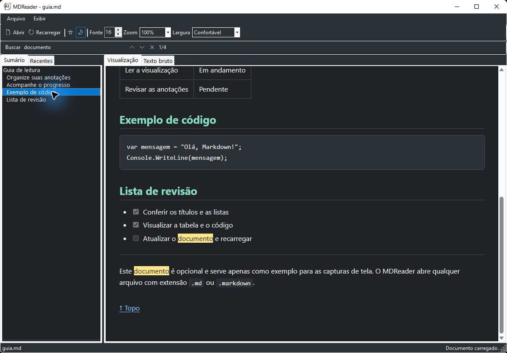
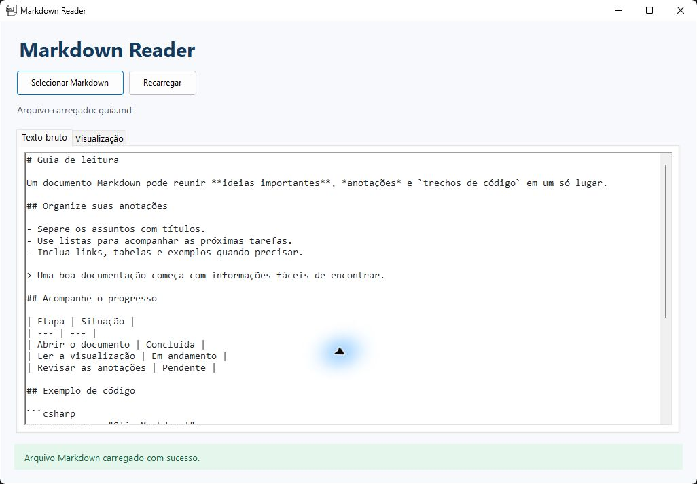
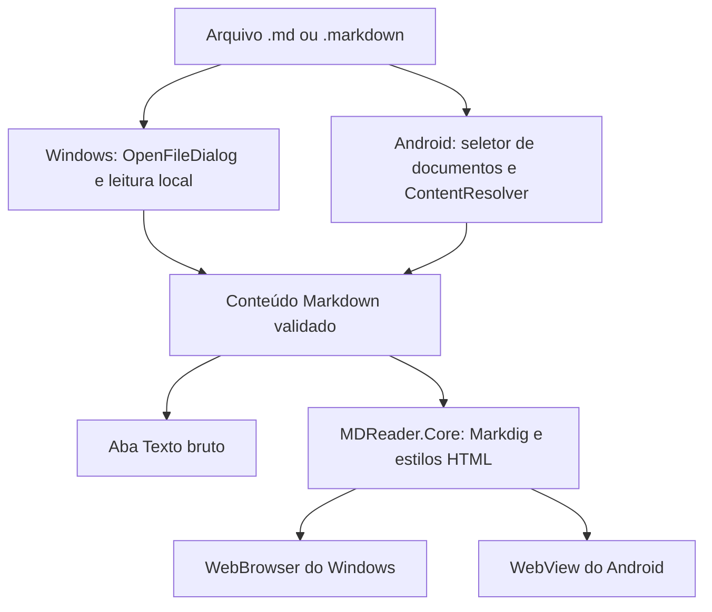

# MDReader

Leitor de Markdown para **Windows e Android**, desenvolvido em C#. Abra arquivos `.md` ou `.markdown`, consulte o texto original e visualize o conteúdo formatado.

A versão Windows usa Windows Forms e gera um `.exe` portátil. A versão Android usa interface nativa com .NET for Android e gera um `.apk` instalável.

A aplicação usa **Markdig** para converter Markdown em HTML e permite recarregar o documento depois de alterações feitas em outro editor.

**Android:** [Pasta do APK](downloads/android) · [Baixar MDReader.apk](https://github.com/PedroHda/MDReader/raw/refs/heads/master/downloads/android/MDReader.apk) · [Release e notas da versão](https://github.com/PedroHda/MDReader/releases/tag/android-v1.0.0)

## Downloads

| Plataforma | Distribuição | Como obter |
| --- | --- | --- |
| Android 8.0 ou superior | APK assinado, versão 1.0.0 | [Abrir pasta do APK](downloads/android) ou [baixar diretamente](https://github.com/PedroHda/MDReader/raw/refs/heads/master/downloads/android/MDReader.apk) |
| Windows 64 bits | Executável portátil | [Executar pelo código-fonte](#executar-pelo-código-fonte) ou [gerar o executável](#gerar-o-executável-portátil) |

O APK pode ser instalado diretamente no celular. A versão Windows é publicada localmente pelo script `publish.ps1`; o executável Windows ainda não está anexado à Release Android.

O instalador Android está visível nos arquivos do repositório em [downloads/android/MDReader.apk](downloads/android/MDReader.apk). Essa cópia é idêntica ao APK da Release `android-v1.0.0` e acompanha um arquivo [SHA256SUMS](downloads/android/SHA256SUMS) para conferir sua integridade.

## Índice

- [Downloads](#downloads)
- [Capturas de tela](#capturas-de-tela)
- [Funcionalidades](#funcionalidades)
- [Tecnologias](#tecnologias)
- [Requisitos](#requisitos)
- [Executar pelo código-fonte](#executar-pelo-código-fonte)
- [Como usar](#como-usar)
- [Gerar o executável portátil](#gerar-o-executável-portátil)
- [Distribuir o aplicativo](#distribuir-o-aplicativo)
- [Versão Android e APK](#versão-android-e-apk)
- [Estrutura do projeto](#estrutura-do-projeto)
- [Renderização e limitações](#renderização-e-limitações)
- [Verificação e testes manuais](#verificação-e-testes-manuais)
- [Solução de problemas](#solução-de-problemas)
- [Contribuições](#contribuições)
- [Licença](#licença)

## Capturas de tela

As imagens abaixo são **capturas reais da aplicação Windows**, usando o documento opcional [guia.md](docs/examples/guia.md). A versão Android possui uma interface nativa própria e não é representada por estas capturas.

### Leitura formatada

Títulos, negrito, itálico, código inline, listas e citações na aba **Visualização**:



### Tabelas e blocos de código

O mesmo documento, após rolar a área de leitura:



### Texto bruto

A aba **Texto bruto** permite consultar a marcação original sem alterar o arquivo:



Para reproduzir essas telas, execute a versão Windows, selecione `docs/examples/guia.md` e alterne entre as abas. O arquivo é apenas um exemplo: o aplicativo não depende dele para funcionar.

## Funcionalidades

- Seleção de arquivos pelo diálogo nativo do Windows.
- Aceitação de `.md` e `.markdown`, sem diferenciar letras maiúsculas de minúsculas.
- Exibição do nome do arquivo carregado.
- Aba **Texto bruto**, com o conteúdo original em modo somente leitura.
- Aba **Visualização**, com o Markdown convertido em HTML.
- Rolagem para leitura de documentos longos.
- Botão **Recarregar**, para atualizar o conteúdo do arquivo atual.
- Mensagens de sucesso, aviso e erro na interface.
- Tratamento de arquivos vazios, extensões não permitidas, caminhos inválidos, arquivos inexistentes e falhas de leitura.
- Ícone próprio na janela e no executável.
- Script para publicar um executável portátil para Windows 64 bits.
- Versão Android com seleção nativa de documentos, texto bruto, pré-visualização e recarregamento.

Entre as marcações processadas pelo Markdig estão títulos, negrito, itálico, tachado, listas, citações, links, imagens, tabelas, checklists, código inline, blocos de código e linhas horizontais.

## Tecnologias

| Tecnologia | Uso no projeto |
| --- | --- |
| C# / .NET | Linguagem e plataforma de execução |
| Windows Forms | Janela, botões, abas e seleção de arquivos |
| `net9.0-windows` | Framework de destino da versão Windows |
| .NET for Android / `net10.0-android` | Interface nativa e empacotamento APK para Android |
| `netstandard2.1` | Biblioteca de leitura e renderização compartilhada |
| Markdig `1.2.0` | Conversão de Markdown para HTML, com `UseAdvancedExtensions()` |
| `WebBrowser` do WinForms | Exibição do HTML na aba de visualização |
| `WebView` do Android | Exibição do HTML no celular |
| PowerShell | Publicação do executável portátil |

A dependência Markdig está declarada em [MDReader.Core.csproj](MDReader.Core/MDReader.Core.csproj) e é restaurada pelo .NET durante a compilação. As duas interfaces utilizam a biblioteca compartilhada.

## Requisitos

### Para desenvolver ou gerar o executável Windows

- Windows.
- SDK do .NET capaz de compilar o destino `net9.0-windows`, como o SDK .NET 9.
- Acesso à internet para restaurar os pacotes e componentes de publicação que ainda não estiverem no cache.
- PowerShell para executar o script de publicação.
- Git, caso queira clonar o repositório pela linha de comando.

Visual Studio é opcional. Também é possível trabalhar com o projeto pelo terminal.

### Para usar o executável portátil

- Windows 64 bits compatível com o runtime .NET incluído na publicação.
- O arquivo `MDReader.exe` gerado pelo script.

A publicação é **self-contained**: inclui o runtime necessário, portanto quem recebe essa versão não precisa instalar o SDK nem o runtime .NET separadamente.

## Executar pelo código-fonte

Clone o repositório e entre na pasta:

```powershell
git clone https://github.com/PedroHda/MDReader.git
cd MDReader
```

Se você já baixou o projeto, abra o PowerShell na pasta que contém `MDReader.sln`.

Confira o SDK disponível:

```powershell
dotnet --info
```

Restaure as dependências e inicie a aplicação:

```powershell
dotnet restore .\MDReader.sln
dotnet run --project .\MDReader\MDReader.csproj
```

Para compilar sem abrir a janela:

```powershell
dotnet build .\MDReader.sln -c Release
```

No Visual Studio, abra `MDReader.sln`, use o projeto `MDReader` como projeto de inicialização e execute com **F5** ou **Ctrl+F5**. O suporte a desenvolvimento desktop com .NET deve estar instalado.

## Como usar

1. Abra a aplicação.
2. Clique em **Selecionar Markdown**.
3. Escolha um arquivo `.md` ou `.markdown` no computador.
4. Consulte o conteúdo original na aba **Texto bruto**.
5. Abra a aba **Visualização** para ler o conteúdo formatado.
6. Depois de editar e salvar o documento em outro programa, clique em **Recarregar**.
7. Para trocar de documento, clique novamente em **Selecionar Markdown**.

O botão **Recarregar** fica disponível depois que um arquivo é carregado. Arquivos vazios ou contendo apenas espaços em branco geram um aviso, sem encerrar a aplicação.

O MDReader é um leitor: não edita nem salva alterações nos arquivos Markdown. A atualização do conteúdo é manual, pelo botão **Recarregar**.

## Gerar o executável portátil

Na raiz do repositório, execute pelo **PowerShell**:

```powershell
.\publish.ps1
```

Se a política de execução impedir o script, use este comando para executá-lo em um processo separado, sem alterar permanentemente a política do sistema:

```powershell
powershell -NoProfile -ExecutionPolicy Bypass -File .\publish.ps1
```

Execute o comando no terminal. Dar dois cliques no arquivo `.ps1` pode abrir seu conteúdo em um editor, dependendo da associação de arquivos do Windows.

O resultado fica em:

```text
dist\MDReader.exe
```

O script publica em **Release** para **`win-x64`**, inclui o runtime .NET, combina os componentes em um arquivo único, habilita compressão e desabilita os símbolos de depuração na saída.

**A pasta `dist` é apagada e recriada a cada publicação.** Mantenha documentos pessoais e arquivos que deseja preservar fora dela.

Para abrir a pasta de saída:

```powershell
explorer .\dist
```

Também é possível gerar a mesma saída diretamente pelo .NET:

```powershell
dotnet publish .\MDReader\MDReader.csproj -c Release -r win-x64 --self-contained true -o .\dist /p:PublishSingleFile=true /p:IncludeNativeLibrariesForSelfExtract=true /p:EnableCompressionInSingleFile=true /p:DebugType=None /p:DebugSymbols=false
```

## Distribuir o aplicativo

1. Gere uma publicação com `publish.ps1`.
2. Compacte o arquivo `dist\MDReader.exe` em um `.zip`, se o serviço de envio não aceitar executáveis.
3. Envie o arquivo ou anexe o pacote a uma Release do GitHub.
4. Quem receber deve extrair o `.zip`, quando houver, e abrir `MDReader.exe`.

O executável pode ser colocado em outra pasta do computador. Ele não depende de permanecer dentro de `bin` ou `dist`, nem exige o código-fonte, o PowerShell ou o Visual Studio para ser usado.

Imagens e outros recursos referenciados por um documento Markdown continuam sendo arquivos separados. Para compartilhar também o documento, preserve a organização dos seus recursos relativos.

As pastas `bin`, `obj`, `dist` e `dist-android` são ignoradas pelo Git. Uma cópia do APK distribuído é versionada na pasta [downloads/android](downloads/android), além de estar disponível na Release do GitHub.

## Versão Android e APK

### Instalar no celular

A versão Android requer **Android 8.0 ou superior** e inclui suporte a ARM de 32 bits, ARM64 e x64. O celular não precisa ter .NET instalado.

1. Abra a pasta [downloads/android](downloads/android) e baixe o [MDReader.apk](https://github.com/PedroHda/MDReader/raw/refs/heads/master/downloads/android/MDReader.apk), ou use a cópia disponível na [Release Android](https://github.com/PedroHda/MDReader/releases/tag/android-v1.0.0).
2. Envie esse arquivo ao celular e abra-o pelo gerenciador de arquivos.
3. Se o Android solicitar, autorize esse gerenciador a instalar aplicativos dessa fonte.
4. Conclua a instalação e abra **MDReader**.
5. Toque em **Abrir arquivo** e selecione um `.md` ou `.markdown`.
6. Alterne entre **Visualização** e **Texto bruto**, ou use o botão de recarregar para atualizar o conteúdo.

O seletor usa o [Storage Access Framework do Android](https://developer.android.com/training/data-storage/shared/documents-files), com acesso ao documento escolhido, sem solicitar permissão ampla para o armazenamento. Quando o provedor permite acesso persistente, o último arquivo é reaberto ao iniciar o aplicativo.

### Gerar novamente o APK

No computador de desenvolvimento, instale o SDK .NET 10, a carga de trabalho `android`, o Android SDK com a plataforma API 36 e um JDK compatível, como o JDK 21. Esses componentes também podem ser instalados pelo suporte Android do Visual Studio.

```powershell
dotnet workload install android
dotnet build .\MDReader.Android.sln -c Release
powershell -NoProfile -ExecutionPolicy Bypass -File .\publish-android.ps1
```

O script gera um **APK Release assinado** em:

```text
dist-android\MDReader.apk
```

Essa pasta é independente de `dist`, usada pelo Windows. A publicação Android substitui apenas o APK de saída e não apaga a distribuição Windows.

A cópia em `downloads/android` representa a versão disponibilizada no repositório. Ao distribuir uma nova versão, atualize o APK dessa pasta e o arquivo `SHA256SUMS` antes de enviar o commit ao GitHub.

Se o SDK ou o JDK estiverem em locais não detectados automaticamente, informe os diretórios:

```powershell
.\publish-android.ps1 -AndroidSdkDirectory "C:\Android\Sdk" -JavaSdkDirectory "C:\Java\jdk-21"
```

Os caminhos acima são exemplos; use as pastas da sua instalação. Para publicar uma atualização, aumente o código da versão e defina o nome exibido:

```powershell
.\publish-android.ps1 -VersionCode 2 -VersionName "1.0.1"
```

Na primeira publicação, o script cria uma chave de assinatura em `.local-signing/mdreader.keystore` e uma senha aleatória protegida pelo Windows em `.local-signing/android-password.clixml`. Essa pasta é ignorada pelo Git. O script reutiliza a mesma chave nas publicações seguintes; as credenciais não são exibidas no terminal.

**Preserve a chave de assinatura e sua senha para instalar futuras versões como atualização.** A senha no arquivo `.clixml` é vinculada ao usuário e ao computador Windows que a criou. Para migrar a assinatura para outra máquina, exporte a senha de forma segura junto com o keystore; apenas copiar o `.clixml` não permite recuperá-la em outro computador.

### Particularidades da versão Android

- Limite de 5 MiB por documento, com leitura em segundo plano e indicador de carregamento.
- Validação da extensão mesmo quando o provedor informa um tipo MIME genérico.
- Tratamento de arquivos vazios, binários, codificação inválida, permissões revogadas e arquivos removidos.
- JavaScript, HTML embutido ativo e acesso direto a arquivos locais são bloqueados na visualização Android.
- Links HTTP/HTTPS são abertos no navegador externo. Imagens HTTPS podem exigir internet.
- Imagens locais relativas não são carregadas: selecionar um documento não concede acesso automático à pasta e aos seus arquivos vizinhos.
- É um leitor, sem edição de documentos, atualização automática ou publicação na Play Store.

O formato APK é configurado com a propriedade [AndroidPackageFormats](https://learn.microsoft.com/dotnet/android/building-apps/build-properties#androidpackageformats). A compilação e os testes automatizados não substituem a verificação em um celular ou emulador; veja os cenários de teste abaixo.

## Estrutura do projeto

```text
MDReader/
|-- .gitignore
|-- MDReader.sln
|-- MDReader.Android.sln
|-- README.md
|-- publish.ps1
|-- publish-android.ps1
|-- downloads/
|   `-- android/
|       |-- MDReader.apk
|       |-- README.md
|       `-- SHA256SUMS
|-- docs/
|   |-- examples/
|   |   `-- guia.md
|   `-- images/
|       |-- logo.png
|       |-- windows-preview.jpg
|       |-- windows-table-code.jpg
|       `-- windows-raw.jpg
|-- MDReader.Core/
|   |-- MDReader.Core.csproj
|   |-- MarkdownContentReader.cs
|   `-- MarkdownHtmlRenderer.cs
|-- MDReader.Core.Tests/
|   |-- MDReader.Core.Tests.csproj
|   `-- MarkdownTests.cs
|-- MDReader.Android/
|   |-- MDReader.Android.csproj
|   |-- AndroidManifest.xml
|   |-- MainActivity.cs
|   |-- Resources/
|   |-- Services/
|   `-- Ui/
|-- MDReader/
|   |-- MDReader.csproj
|   |-- Program.cs
|   |-- Assets/
|   |   `-- MD.ico
|   |-- Models/
|   |   `-- MarkdownDocument.cs
|   |-- Rendering/
|   |   `-- MarkdownPreviewRenderer.cs
|   |-- Services/
|   |   |-- MarkdownFileException.cs
|   |   |-- MarkdownFileReader.cs
|   |   `-- MarkdownFileValidator.cs
|   `-- Ui/
|       |-- MainForm.cs
|       `-- MainForm.resx
|-- dist/                         # Executável Windows; ignorada pelo Git
|-- dist-android/                 # APK Android; ignorada pelo Git
`-- .local-signing/               # Assinatura privada local; ignorada pelo Git
```

| Arquivo | Responsabilidade |
| --- | --- |
| [Program.cs](MDReader/Program.cs) | Inicializa o Windows Forms e abre a janela principal |
| [MainForm.cs](MDReader/Ui/MainForm.cs) | Monta a interface, abre o seletor e apresenta documentos e mensagens |
| [MarkdownDocument.cs](MDReader/Models/MarkdownDocument.cs) | Representa o caminho, nome e conteúdo do documento e identifica conteúdo vazio |
| [MarkdownFileValidator.cs](MDReader/Services/MarkdownFileValidator.cs) | Valida o caminho, a existência do arquivo e a extensão |
| [MarkdownFileReader.cs](MDReader/Services/MarkdownFileReader.cs) | Lê o arquivo com `File.ReadAllText` e trata falhas de acesso e leitura |
| [MarkdownFileException.cs](MDReader/Services/MarkdownFileException.cs) | Define as exceções específicas de validação e leitura |
| [MarkdownPreviewRenderer.cs](MDReader/Rendering/MarkdownPreviewRenderer.cs) | Integra o HTML compartilhado ao controle WinForms e define a base dos recursos locais |
| [MarkdownHtmlRenderer.cs](MDReader.Core/MarkdownHtmlRenderer.cs) | Converte Markdown em HTML com estilos adaptáveis para as duas interfaces |
| [MarkdownContentReader.cs](MDReader.Core/MarkdownContentReader.cs) | Valida a extensão e lê streams com limite de tamanho e cancelamento no Android |
| [MainActivity.cs](MDReader.Android/MainActivity.cs) | Interface Android, seleção, recarga, mensagens e estado do documento |
| [AndroidMarkdownFileReader.cs](MDReader.Android/Services/AndroidMarkdownFileReader.cs) | Obtém nome e conteúdo do documento pelo ContentResolver do Android |
| [publish.ps1](publish.ps1) | Gera o executável portátil na pasta `dist` |
| [publish-android.ps1](publish-android.ps1) | Assina e gera o APK na pasta `dist-android` |

`MDReader.sln` contém os projetos necessários à versão Windows. `MDReader.Android.sln` contém a versão Android, a biblioteca compartilhada e os testes, permitindo desenvolver para Windows sem instalar as ferramentas Android.

O fluxo principal é: **seleção do arquivo > validação > leitura > documento > texto bruto e HTML renderizado**.



No Android, a leitura de streams também utiliza `MarkdownContentReader`, com limite de tamanho e cancelamento. No Windows, `MarkdownFileReader` mantém a leitura local com `File.ReadAllText`. As duas interfaces compartilham a conversão para HTML.

## Renderização e limitações

- No Windows, a visualização usa o controle `WebBrowser` do WinForms, que utiliza o mecanismo legado de renderização do Windows. A aparência pode diferir de navegadores modernos e do GitHub.
- No Windows, o diretório do arquivo Markdown é usado como base para resolver caminhos relativos, como ``.
- A leitura de arquivos locais não exige conexão. Imagens e outros recursos com endereços remotos podem precisar de acesso à internet.
- Os blocos de código são formatados visualmente, mas não há destaque de sintaxe por linguagem integrado.
- Não há renderização integrada de diagramas Mermaid nem de fórmulas matemáticas com MathJax ou KaTeX.
- A visualização Windows permite HTML embutido e não inclui uma etapa de sanitização. Abra documentos de fontes confiáveis. No Android, o HTML embutido é escapado, e o WebView mantém JavaScript desabilitado.
- A leitura usa UTF-8 por padrão, com detecção de marca de codificação (BOM) pelo .NET. Não há seletor de codificação na interface.
- No Windows, o arquivo inteiro é lido e renderizado de uma vez. Documentos muito grandes podem deixar a interface temporariamente ocupada. No Android, a leitura ocorre em segundo plano e tem limite de tamanho.
- O script `publish.ps1` publica para Windows 64 bits (`win-x64`); `publish-android.ps1` publica para Android. Não há instalador Windows, associação automática de arquivos ou atualização automática implementados.

## Verificação e testes manuais

Para conferir a compilação e a formatação do código:

```powershell
dotnet build .\MDReader.sln
dotnet format .\MDReader.sln --verify-no-changes
dotnet test .\MDReader.Core.Tests\MDReader.Core.Tests.csproj
dotnet build .\MDReader.Android.sln -c Release
dotnet format .\MDReader.Android.sln --verify-no-changes
```

Os testes xUnit verificam as marcações Markdown, a configuração HTML para cada plataforma, as extensões permitidas, as codificações UTF-8/UTF-16, arquivos vazios, conteúdo binário, cancelamento e limite de tamanho. Execute-os com SDK .NET 10.

Use estes cenários para verificar o comportamento da interface Windows:

| Cenário | Resultado esperado |
| --- | --- |
| Abrir um `.md` ou `.markdown` válido | Nome do arquivo, texto bruto, visualização e mensagem de sucesso |
| Abrir um arquivo com extensão `.MD` | Arquivo aceito normalmente |
| Selecionar outra extensão usando o filtro de todos os arquivos | Mensagem de extensão não permitida |
| Abrir um arquivo vazio ou contendo apenas espaços | Aviso de arquivo vazio; aplicação continua aberta |
| Cancelar o seletor | O documento atual permanece carregado |
| Editar e salvar o arquivo em outro editor; clicar em Recarregar | Conteúdo atualizado nas duas abas |
| Remover ou mover o arquivo; clicar em Recarregar | Mensagem amigável de arquivo inexistente |
| Abrir um arquivo sem permissão de leitura | Mensagem amigável de falha de acesso |
| Abrir um documento longo | Conteúdo acessível pela rolagem |
| Abrir o executável publicado em outra pasta | Aplicação inicia sem depender da pasta do projeto |

No Android, confira também:

| Cenário | Resultado esperado |
| --- | --- |
| Instalar e abrir o APK | Tela inicial com seletor e abas |
| Escolher um documento em Downloads ou em um provedor de arquivos | Nome, texto bruto e HTML exibidos |
| Escolher uma extensão não permitida | Erro amigável, preservando o documento anterior |
| Recarregar um documento editado, vazio ou removido | Atualização ou aviso correspondente, sem encerrar o app |
| Girar o celular e alternar entre as abas | Documento continua acessível, sem sobrepor as barras do sistema |
| Fechar e abrir o app após selecionar um arquivo persistente | Último documento é reaberto |
| Abrir documento com HTML/JavaScript embutido | Código não é executado pelo WebView |
| Escolher um arquivo maior que o limite | Mensagem de tamanho máximo |
| Publicar uma atualização com a mesma chave e código de versão maior | Instalação como atualização da versão anterior |

Para conferir a formatação, crie um arquivo `.md` com este conteúdo opcional:

````markdown
# Documento de teste

## Formatação

**Negrito**, *itálico*, ~~tachado~~ e `código inline`.

> Uma citação de exemplo.

- Primeiro item
- Segundo item
    - Subitem

1. Etapa um
2. Etapa dois

- [x] Documento aberto
- [ ] Conferir visualização

| Recurso | Situação |
| --- | --- |
| Texto bruto | Disponível |
| Visualização | Disponível |

```csharp
Console.WriteLine("Olá, Markdown!");
```

---
````

Esse arquivo é apenas uma sugestão de teste. A aplicação pode abrir qualquer arquivo com uma das extensões permitidas.

## Solução de problemas

| Problema | O que verificar |
| --- | --- |
| `dotnet` não é reconhecido | Instale o SDK .NET compatível e abra um novo terminal |
| O `.ps1` abre no Bloco de Notas | Execute o comando no PowerShell, conforme a seção de publicação |
| Scripts estão desabilitados | Use o comando com `-ExecutionPolicy Bypass` mostrado acima |
| O projeto ou script não é encontrado | Abra o terminal na raiz do repositório, onde está `MDReader.sln` |
| O executável não aparece em `dist` | Confira se o publish terminou com sucesso e revise os erros do terminal |
| A publicação não consegue substituir o executável | Feche a cópia do MDReader aberta a partir de `dist` e tente novamente |
| Extensão não permitida | Selecione um documento Markdown com extensão `.md` ou `.markdown` |
| Conteúdo desatualizado | Salve o documento no editor e clique em **Recarregar** |
| Acentos incorretos no documento | Salve o arquivo como UTF-8 no editor e recarregue |
| Imagem local não aparece | Verifique o caminho relativo à pasta do documento e a existência da imagem |
| Uma sintaxe aparece como texto ou com aparência diferente | Consulte as limitações de renderização e compare com a aba **Texto bruto** |
| O build Android informa workload ausente | Instale a carga de trabalho `android` do .NET 10 |
| Android SDK ou JDK não encontrado | Confira a instalação e use os parâmetros de diretório do script Android |
| Android não consegue atualizar uma instalação existente | Use o APK assinado com a mesma chave e um código de versão maior |
| Android perdeu acesso ao documento | Toque em **Abrir arquivo** e conceda acesso novamente pelo seletor |

## Contribuições

Relate problemas nas [Issues do repositório](https://github.com/PedroHda/MDReader/issues), incluindo a mensagem exibida e um trecho mínimo de Markdown que reproduza o comportamento, sem dados pessoais.

Para contribuir com código, crie um branch, faça a alteração e execute as verificações de compilação e formatação antes de abrir um pull request. Descreva o comportamento esperado e como a mudança foi testada.

## Licença

O repositório ainda não contém um arquivo `LICENSE`. Uma licença de uso, modificação e redistribuição precisa ser definida pelo autor.
