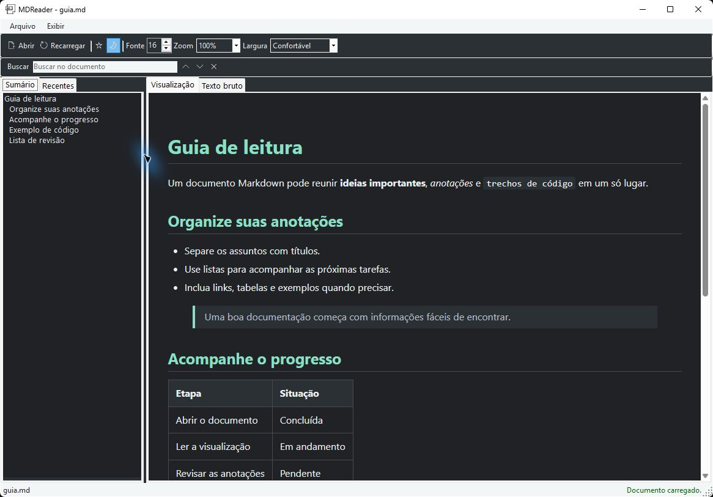
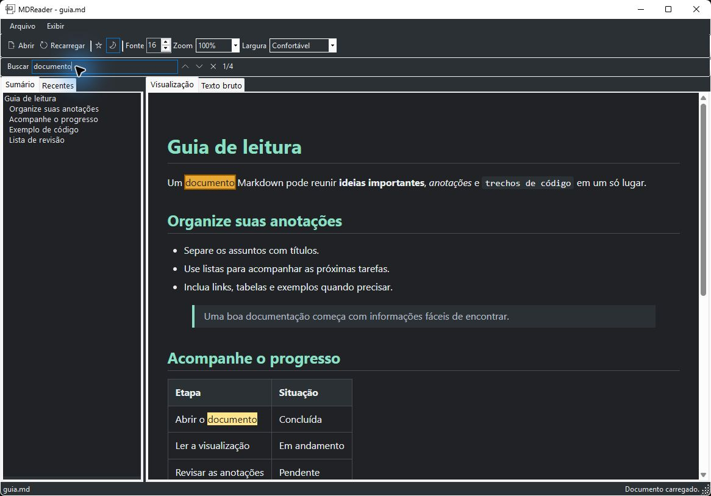
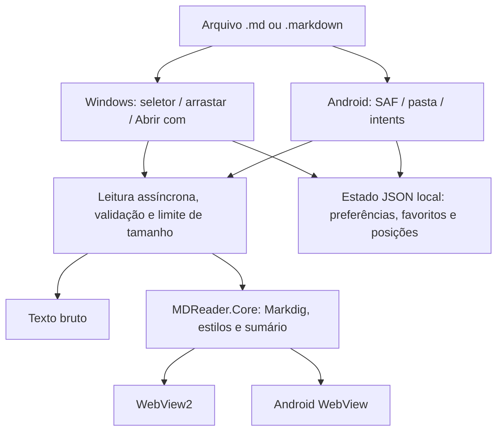

# MDReader

Leitor de Markdown para **Windows e Android**, desenvolvido em C# com .NET 10. Abra arquivos `.md` ou `.markdown`, leia o conteúdo formatado ou consulte o texto original, sem modificar seus documentos.

**Versão 1.1.0:** WebView2 no Windows, modo escuro, busca, sumário, favoritos, histórico e preferências de leitura.

**Correção Android 1.1.1:** resolve o fechamento imediato na inicialização do APK Release. O executável Windows permanece na versão 1.1.0.

## Downloads

| Plataforma | Arquivo | Requisitos |
| --- | --- | --- |
| Windows x64 | [MDReader.exe](https://github.com/PedroHda/MDReader/raw/refs/heads/master/downloads/windows/MDReader.exe) · [Pasta Windows](downloads/windows) | Windows 64 bits e WebView2 Runtime |
| Android | [MDReader.apk](https://github.com/PedroHda/MDReader/raw/refs/heads/master/downloads/android/MDReader.apk) · [Pasta Android](downloads/android) | Android 8.0 ou superior; ARM, ARM64 ou x64 |

[Releases e notas das versões](https://github.com/PedroHda/MDReader/releases) · [Histórico de builds](https://github.com/PedroHda/MDReader/actions)

O executável Windows é portátil e inclui o runtime .NET. Pode ficar em qualquer pasta, sem depender de `bin`, do código-fonte ou do Visual Studio. O componente de renderização [WebView2 Runtime](https://developer.microsoft.com/microsoft-edge/webview2/) precisa estar instalado; quando indisponível, a leitura de texto bruto continua acessível.

O APK é assinado com a chave do projeto. Não exige .NET no celular. Baixe-o e abra pelo gerenciador de arquivos; o Android pode solicitar autorização para instalar aplicativos dessa fonte. Para atualizar uma instalação existente, a assinatura deve ser a mesma.

Os arquivos [SHA256SUMS do Windows](downloads/windows/SHA256SUMS) e [SHA256SUMS do Android](downloads/android/SHA256SUMS) permitem conferir os downloads:

```powershell
Get-FileHash .\downloads\windows\MDReader.exe -Algorithm SHA256
Get-FileHash .\downloads\android\MDReader.apk -Algorithm SHA256
```

## Índice

- [Capturas de tela](#capturas-de-tela)
- [Funcionalidades](#funcionalidades)
- [Como usar](#como-usar)
- [Tecnologias e arquitetura](#tecnologias-e-arquitetura)
- [Executar pelo código-fonte](#executar-pelo-código-fonte)
- [Publicação local](#publicação-local)
- [Builds e releases automáticas](#builds-e-releases-automáticas)
- [Segurança e privacidade](#segurança-e-privacidade)
- [Limitações](#limitações)
- [Testes](#testes)
- [Solução de problemas](#solução-de-problemas)

## Capturas de tela

Capturas **reais da versão Windows 1.1.0**, usando o documento opcional [guia.md](docs/examples/guia.md). Não são representações da interface Android.

### Leitura formatada e sumário


### Modo escuro



### Busca no documento



### Tabelas e código


### Texto bruto


O documento de exemplo não é necessário para executar o aplicativo.

## Funcionalidades

| Recurso | Windows | Android |
| --- | --- | --- |
| Seletor nativo de arquivos e validação de extensão | Sim | Sim |
| Markdown formatado e texto bruto somente leitura | Sim | Sim |
| Busca e navegação entre resultados | Sim | Sim |
| Sumário clicável a partir dos títulos | Painel lateral | Menu Sumário |
| Modo escuro, fonte, zoom e largura de leitura | Barra de ferramentas | Menu Aparência |
| Recentes, favoritos e retomada de leitura | Sim | Sim |
| Recarga manual | Sim | Sim |
| Recarga automática ao detectar alterações | FileSystemWatcher | ContentObserver do provedor |
| Arrastar um arquivo para a janela | Sim | Não |
| Integração Abrir com / compartilhamento | Registro opcional por usuário | Arquivos recebidos via intents |
| Imagens relativas do documento | Na pasta do arquivo | Ao abrir por uma pasta autorizada |
| Acesso a uma pasta e subpastas | Pelo seletor do sistema | Menu Abrir pasta |

A renderização com Markdig inclui títulos, negrito, itálico, tachado, listas e sublistas, citações, links, imagens, tabelas, checklists, notas de rodapé, código inline, blocos de código e linhas horizontais.

A leitura ocorre em segundo plano e tem limite de **5 MiB por documento**, em ambas as plataformas. Arquivos vazios são aceitos com aviso. Extensões inválidas, binários, codificação inválida, arquivos removidos, permissões revogadas e falhas de leitura geram mensagens amigáveis, preservando o documento anterior sempre que possível.

## Como usar

### Windows

1. Abra `MDReader.exe` e clique em **Abrir**, ou arraste um arquivo para a janela.
2. Escolha um `.md` ou `.markdown`.
3. Alterne entre **Visualização** e **Texto bruto**.
4. Use o painel **Sumário** para ir a um título ou **Recentes** para reabrir um documento.
5. Use a estrela para favoritar; favoritos aparecem primeiro no histórico.
6. Ajuste o modo escuro, fonte, zoom e largura na barra superior.
7. Edite o documento em outro programa e salve. A recarga automática pode ser desativada no menu **Arquivo**; o botão **Recarregar** continua disponível.

O menu **Arquivo > Registrar no menu Abrir com** adiciona o executável atual às opções do Windows, apenas para o usuário atual. Não muda o aplicativo padrão. Registre depois de colocar o executável no local definitivo; se o mover, registre novamente.

Também é possível iniciar com um documento como argumento:

```powershell
.\downloads\windows\MDReader.exe "C:\Documentos\anotacoes.md"
```

| Atalho | Ação |
| --- | --- |
| Ctrl+O | Abrir arquivo |
| F5 | Recarregar |
| Ctrl+F | Focar a busca |
| Enter / F3 | Próximo resultado |
| Shift+Enter / Shift+F3 | Resultado anterior |
| Escape na busca | Limpar busca |
| Ctrl+Shift+D | Alternar modo escuro |

### Android

1. Instale o APK e toque em **Abrir arquivo**.
2. Escolha um documento no seletor do Android.
3. Alterne entre **Visualização** e **Texto bruto** e use a busca e suas setas.
4. No menu de três pontos, abra **Recentes e favoritos**, **Sumário** ou **Aparência**.
5. Para documentos com imagens relativas, use **Abrir pasta**, autorize a pasta do documento e escolha o Markdown dentro dela.

Selecionar somente um arquivo não concede acesso às imagens vizinhas. O modo pasta usa o Storage Access Framework, sem pedir acesso amplo ao armazenamento. O provedor precisa oferecer acesso persistente para reabrir documentos depois que o app for fechado. A recarga automática depende das notificações do provedor; ao voltar ao app, ele também tenta atualizar o documento.

O aplicativo aceita arquivos enviados por **Abrir com** ou **Compartilhar** quando o outro aplicativo fornece uma URI de conteúdo e um nome terminado em `.md` ou `.markdown`. Compartilhamento de texto avulso não é importado como arquivo.

## Tecnologias e arquitetura

| Tecnologia | Responsabilidade |
| --- | --- |
| C# / .NET 10 | Linguagem e plataforma compartilhadas |
| Windows Forms / `net10.0-windows` | Interface desktop nativa |
| Microsoft.Web.WebView2 `1.0.4314.35` | Renderização moderna no Windows |
| .NET for Android / `net10.0-android` | Interface Android nativa e APK |
| Markdig `1.2.0` | Parser Markdown e extensões |
| System.Text.Json | Preferências, histórico e posições locais |
| xUnit / Microsoft.NET.Test.Sdk | Testes automatizados |
| PowerShell / GitHub Actions | Publicação, checksums e automação |

As dependências estão declaradas nos arquivos `.csproj` e são restauradas pelo .NET. Não há servidor, banco de dados ou cadastro obrigatório.



```text
.github/workflows/         Builds, testes e publicação por tag
MDReader/                  Aplicativo Windows Forms
  Rendering/               Sessão WebView2, ícones e integração HTML
  Services/                Validação, leitura e integração Abrir com
  Ui/                      Janela e eventos da interface
MDReader.Android/          Aplicativo Android nativo
  Services/                ContentResolver e navegação de pastas SAF
  Ui/                      WebView seguro e busca nativa
MDReader.Core/             Leitura, renderização, sumário e histórico
  Assets/                  CSS compartilhado e busca controlada do Windows
MDReader.Core.Tests/       Testes de leitura, segurança e preferências
docs/                      Capturas reais, exemplo e notas de versão
downloads/android/         APK distribuído, versão e checksum
downloads/windows/         EXE distribuído, versão e checksum
scripts/                   Automação de releases e pasta downloads
publish.ps1                Publicação Windows
publish-android.ps1         Publicação Android assinada
```

`MDReader.sln` contém Windows e Core, sem exigir as ferramentas Android. `MDReader.Android.sln` contém Android, Core e testes. A lógica compartilhada é independente das interfaces.

## Executar pelo código-fonte

### Windows

Requisitos: Windows, SDK .NET 10, WebView2 Runtime e internet para restaurar dependências.

```powershell
git clone https://github.com/PedroHda/MDReader.git
cd MDReader
dotnet restore .\MDReader.sln
dotnet build .\MDReader.sln -c Release
dotnet run --project .\MDReader\MDReader.csproj
```

No Visual Studio, instale o suporte a desenvolvimento desktop com .NET, abra `MDReader.sln` e selecione `MDReader` como projeto de inicialização.

### Android

Requisitos adicionais: workload `android`, Android SDK API 36 / build-tools 36.0.0 e JDK 21.

```powershell
dotnet workload install android
dotnet build .\MDReader.Android.sln -c Debug
```

Se necessário, informe a instalação local:

```powershell
dotnet build .\MDReader.Android\MDReader.Android.csproj -c Debug -p:AndroidSdkDirectory="C:\Android\Sdk" -p:JavaSdkDirectory="C:\Java\jdk-21"
```

Esses caminhos são exemplos, não caminhos fixos do aplicativo. Use um celular ou emulador configurado para executar a interface Android.

## Publicação local

### Executável Windows

Execute no PowerShell, na raiz do repositório:

```powershell
.\publish.ps1
```

Se a política de execução bloquear o script:

```powershell
powershell -NoProfile -ExecutionPolicy Bypass -File .\publish.ps1
```

Dar dois cliques em um `.ps1` pode abrir o Bloco de Notas. O comando acima executa o script sem mudar permanentemente a política do sistema.

Saída: **`dist\MDReader.exe`**, Release, `win-x64`, self-contained e arquivo único com compressão. O script atualiza os arquivos de publicação, sem apagar recursivamente a pasta. Não coloque documentos pessoais na saída de build.

Para distribuir, envie apenas o EXE, ou compacte-o em ZIP se o serviço de envio bloquear executáveis. O destinatário não precisa do SDK .NET; precisa do WebView2 Runtime para a visualização formatada.

### APK assinado

```powershell
.\publish-android.ps1
# Com instalações do SDK/JDK não detectadas automaticamente:
.\publish-android.ps1 -AndroidSdkDirectory "C:\Android\Sdk" -JavaSdkDirectory "C:\Java\jdk-21"
```

Saída: **`dist-android\MDReader.apk`**. Windows e Android têm pastas de saída independentes.

Na primeira publicação local, o script cria a assinatura em `.local-signing/mdreader.keystore` e uma senha protegida pelo Windows em `.local-signing/android-password.clixml`. A pasta é ignorada pelo Git. Publicações seguintes reutilizam a chave.

**Preserve a chave e a senha em backup seguro.** A senha CLIXML é vinculada ao usuário e ao computador Windows. Copiar apenas esse arquivo para outra máquina não permite recuperá-la.

Ao atualizar o APK, aumente o código da versão:

```powershell
.\publish-android.ps1 -VersionName "1.1.1" -VersionCode 10101
```

Para atualizar as cópias públicas e os checksums, após gerar ambas as plataformas:

```powershell
.\scripts\Update-Downloads.ps1 -AndroidApk .\dist-android\MDReader.apk -WindowsExe .\dist\MDReader.exe -Version "1.1.0"
```

As saídas intermediárias `bin`, `obj`, `dist` e `dist-android` são ignoradas pelo Git; as cópias em `downloads` são versionadas.

Para atualizar somente o APK, sem substituir o executável Windows:

```powershell
.\scripts\Update-Downloads.ps1 -AndroidApk .\dist-android\MDReader.apk -Version "1.1.1"
```

## Builds e releases automáticas

O workflow [ci.yml](.github/workflows/ci.yml) executa testes e builds em pushes para `master` e pull requests. Publica artefatos temporários do Windows e um APK **Debug**, não destinado à distribuição como atualização do APK Release.

O workflow [release.yml](.github/workflows/release.yml) é acionado por tags `vMAJOR.MINOR.PATCH`. Ele gera EXE e APK Release, publica uma GitHub Release com checksums e atualiza `downloads` em `master`.

Antes de usar a publicação automática, o mantenedor precisa configurar em **Settings > Secrets and variables > Actions**:

| Secret | Conteúdo |
| --- | --- |
| `ANDROID_KEYSTORE_BASE64` | Keystore de produção codificado em Base64 |
| `ANDROID_SIGNING_PASSWORD` | Senha da mesma chave, alias `mdreader` |

Esses secrets **não são configurados pelo código** e nunca devem ser commitados. Use a chave existente para permitir atualização das instalações atuais. O workflow precisa poder escrever conteúdo no repositório; regras de proteção de branch podem bloquear a atualização de `downloads`.

Depois da configuração e de enviar os commits:

```powershell
git tag v1.1.1
git push origin v1.1.1
```

O código Android é calculado como `major * 10000 + minor * 100 + patch`; minor e patch devem estar entre 0 e 99. Atualize também as versões dos projetos e [docs/release-notes.md](docs/release-notes.md) antes de uma nova versão. Uma Release pode ser publicada manualmente com os scripts locais enquanto os secrets não estiverem configurados.

## Segurança e privacidade

- O aplicativo não altera os arquivos Markdown e não envia o histórico a um servidor próprio.
- HTML embutido é escapado nas duas plataformas. Scripts do documento, frames e formulários são bloqueados.
- No Windows, somente o código interno de busca e aparência é executado pela aplicação; o conteúdo Markdown não é avaliado como JavaScript nem recebe objetos nativos.
- No Android, JavaScript permanece desabilitado; a busca usa as APIs nativas do WebView.
- Imagens locais são limitadas aos caminhos de imagem sob a pasta do documento/autorizada. Travessia `../`, caminhos absolutos e extensões não permitidas são rejeitados.
- Imagens HTTPS remotas podem acessar a internet quando o documento é aberto. Links HTTP/HTTPS abrem no navegador externo.
- Histórico, nomes, caminhos, favoritos, preferências e posições são salvos localmente, em JSON sem criptografia. Evite compartilhar esse arquivo caso os caminhos sejam sensíveis.
- Windows: `%LOCALAPPDATA%\MDReader\reader-state.json`; o perfil WebView2 e um cache HTML ficam no mesmo diretório do aplicativo.
- Android: armazenamento interno privado do aplicativo. Permissões persistentes são concedidas apenas pelo seletor do sistema.
- Chaves, senhas e credenciais não fazem parte da distribuição nem do repositório.

## Limitações

- É um leitor, não um editor de Markdown.
- Não há sincronização na nuvem, login, versão iOS, instalador Windows ou atualização automática do próprio aplicativo.
- Atualização automática do **conteúdo** não é atualização automática do **executável**.
- Não há destaque de sintaxe por linguagem, Mermaid ou renderização matemática integrada.
- HTML embutido aparece como texto por segurança. O visual pode diferir de GitHub ou de outros leitores.
- UTF-8 é o padrão; BOM de UTF-8/UTF-16 é reconhecido. Não há seletor manual de codificação.
- Busca formatada pode não combinar uma expressão que atravesse elementos de formatação diferentes. No Windows e no texto bruto Android, os destaques são limitados a 1.000 ocorrências.
- Imagens locais Android exigem abertura a partir da pasta autorizada. Arquivos selecionados isoladamente não concedem esse acesso.
- A retomada da leitura usa uma posição proporcional; alterações no conteúdo ou no tamanho da janela podem deslocar o trecho exibido.
- O histórico mantém até 100 documentos. Permissões revogadas ou arquivos movidos exigem nova seleção.

## Testes

```powershell
dotnet test .\MDReader.Core.Tests\MDReader.Core.Tests.csproj -c Release
dotnet build .\MDReader.sln -c Release
dotnet build .\MDReader.Android.sln -c Debug
```

A suíte cobre marcações Markdown, HTML não executável, links internos, extração de sumário, leitura UTF-8/UTF-16, arquivos vazios/binários, cancelamento, limite de tamanho, extensões, caminhos de imagens, preferências corrompidas, favoritos e restauração de estado.

O workflow [Android startup](.github/workflows/android-startup.yml) instala o APK de `downloads/android` em emuladores Android 8 (API 26) e Android 15 (API 35), verifica a tela inicial e reabre o app. Falhas incluem logs e captura de tela nos artefatos da execução. Esse teste executa o APK Release distribuído, não apenas uma compilação Debug.

### Verificação manual

| Cenário | Resultado esperado |
| --- | --- |
| Abrir `.md`, `.markdown` ou extensão em maiúsculas | Nome e conteúdo nas duas abas |
| Selecionar extensão diferente, arquivo removido ou sem acesso | Mensagem amigável; app permanece aberto |
| Abrir arquivo vazio | Aviso, sem encerrar o aplicativo |
| Buscar texto e navegar pelas setas | Resultado destacado e navegação entre ocorrências |
| Clicar em um título do sumário | Rolagem até o título correto |
| Alterar tema, fonte, zoom e largura; reiniciar | Preferências restauradas |
| Favoritar e reabrir um documento | Favorito preservado, posição retomada aproximadamente |
| Salvar o arquivo em outro editor | Recarga automática, quando habilitada e suportada |
| Inserir HTML/JavaScript no Markdown | Código não executado |
| Imagens sob a pasta do documento / fora dela | Imagem válida acessível; caminho fora da pasta bloqueado |
| Rodar EXE fora da pasta do projeto | App inicia normalmente |
| Android: Abrir pasta, selecionar documento com imagem | Acesso apenas pela pasta autorizada |
| Android: Compartilhar arquivo / Abrir com | Documento recebido e extensão validada |
| Atualizar APK com mesma chave e versão maior | Instalação como atualização |

A validação desta versão inclui build Windows/Android e testes automatizados. As capturas documentam testes reais no Windows. O emulador Android desta máquina não iniciou por falta de aceleração de hardware; a interface Android ainda requer verificação em dispositivo ou emulador funcional.

## Solução de problemas

| Problema | Solução |
| --- | --- |
| `dotnet` não reconhecido | Instale o SDK .NET 10 e reabra o terminal |
| `.ps1` abre no Bloco de Notas | Execute-o pelo PowerShell, conforme os comandos acima |
| Projeto ou script não encontrado | Abra o terminal na raiz que contém `MDReader.sln` |
| Visualização Windows indisponível | Instale o WebView2 Runtime; consulte o texto bruto enquanto isso |
| Publish não consegue substituir o EXE | Feche a cópia em execução na pasta de saída |
| Imagem local não aparece | Confira o caminho; no Android, use Abrir pasta |
| Acentos incorretos | Salve como UTF-8 no editor e recarregue |
| Arquivo não atualiza | Salve no editor, habilite recarga automática ou use Recarregar |
| Android perdeu acesso | Selecione novamente o documento ou a pasta |
| Android não instala como atualização | Confira assinatura e código de versão maior |
| Workload Android ausente | Execute `dotnet workload install android` |
| SDK/JDK não encontrado | Informe os parâmetros de diretório ao script |
| Release automática falha por assinatura | Configure os dois secrets e preserve o alias `mdreader` |
| Histórico não foi salvo | Confira acesso ao armazenamento local; documentos originais não são afetados |

## Contribuições e licença

Relate problemas nas [Issues](https://github.com/PedroHda/MDReader/issues), incluindo a mensagem e um trecho mínimo de Markdown que reproduza a falha, sem dados pessoais. Execute os testes e builds relacionados antes de abrir um pull request.

O repositório ainda não contém um arquivo `LICENSE`. A licença de uso, modificação e redistribuição precisa ser definida pelo autor.
